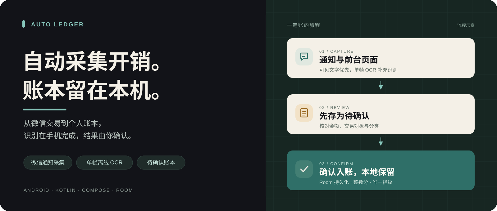
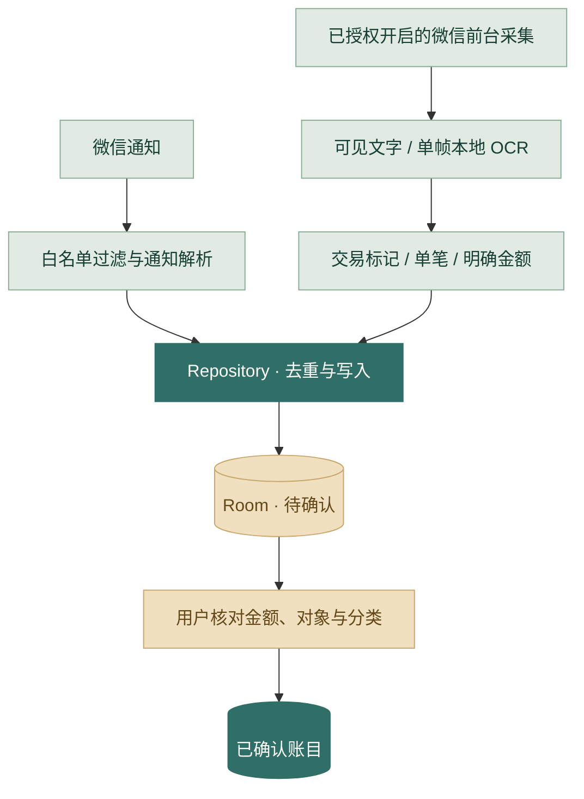

<p align="center">
  
</p>

<h1 align="center">Auto Ledger</h1>

<p align="center"><strong>自动采集开销，账本留在本机。</strong></p>
<p align="center">面向个人使用的 Android 离线记账应用 · 微信通知采集 · 单帧本地 OCR · 待确认账本</p>

<p align="center">
  <a href="app/build.gradle.kts"></a>
  <a href="gradle/libs.versions.toml"></a>
  <a href="app/src/main/java/com/liwenzhong/autoledger/ui/AutoLedgerApp.kt"></a>
  <a href="PRIVACY.md"></a>
  <a href="LICENSE"></a>
</p>

<p align="center">
  <a href="https://github.com/liwenzhonhg-arch/auto-ledger/releases">下载测试版</a> ·
  <a href="docs/GETTING_STARTED.md">使用与构建</a> ·
  <a href="docs/ARCHITECTURE.md">架构与取舍</a> ·
  <a href="docs/VERIFICATION.md">验证记录</a> ·
  <a href="PRIVACY.md">隐私说明</a>
</p>



## 为什么做这个项目

支付完成后再打开记账软件手动录入，很容易遗漏。Auto Ledger 尝试在手机本地完成这一步：优先解析微信交易通知；没有通知时，在用户显式开启后读取微信前台交易页面，必要时以单帧截图和离线 OCR 补充识别。

识别出的记录先进入 **待确认**，由用户核对金额、对象和分类后确认入账。项目关注的是 Android 采集链路、数据一致性和隐私约束下的工程实现。

> **开发版状态**：当前主要支持微信，最低 Android 16。手动记账保存、自动分类、其他支付来源和 CSV 导出仍在计划中。源码采用 [MIT 许可证](LICENSE) 公开提供，测试 APK 可从 [Releases](https://github.com/liwenzhonhg-arch/auto-ledger/releases) 直接下载。

## 能做什么

| 能力 | 当前实现 |
| --- | --- |
| 微信通知自动采集 | 系统授权且服务连接后自动解析；重连时补处理仍在通知栏的微信通知 |
| 微信页面采集 | 前台事件触发，优先读取可见文字；无法形成候选时使用单帧离线 OCR |
| 账目核对与持久化 | Room v1 保存待确认记录，支持修改金额、对象和分类后确认；金额使用整数分 |
| 月度账本与统计 | 本月收支、日期分组明细、周／月／年支出趋势、分类排行 |
| 采集状态诊断 | 区分授权、开关和连接状态；最近 12 条处理结果及独立的最近保存／失败时间 |
| 本地隐私边界 | 无网络权限；原始通知、页面文字与截图不落盘；OCR 模型随 APK 分发 |

首页和统计页目前包含 **待确认与已确认** 记录，展示时标注待确认金额；不能将这些汇总直接当作全部已核实的账目。

## 工程上值得展开的四件事

| 问题 | 实现与取舍 | 代码入口 |
| --- | --- | --- |
| 通知缺失或页面读不到文字 | 通知与前台页面两条路径；事件合并、单帧 OCR，同一时刻只处理一帧 | [通知服务](app/src/main/java/com/liwenzhong/autoledger/notification/WeChatNotificationListenerService.kt) · [无障碍服务](app/src/main/java/com/liwenzhong/autoledger/accessibility/WeChatAccessibilityService.kt) |
| 内容相同不等于同一笔交易 | 页面内容指纹只合并 90 秒内的重复采集；查重和写入在同一 Room 事务中完成 | [Repository](app/src/main/java/com/liwenzhong/autoledger/repository/LedgerRepository.kt) · [去重测试](app/src/test/java/com/liwenzhong/autoledger/repository/ScreenObservationDeduplicationTest.kt) |
| 一次识别失败不能卡住后续采集 | 在 `finally` 中释放位图及忙碌状态；入库失败返回明确状态，协程取消继续向上传播 | [OCR](app/src/main/java/com/liwenzhong/autoledger/capture/OfflineOcrRecognizer.kt) · [失败恢复测试](app/src/test/java/com/liwenzhong/autoledger/repository/IngestionRecoveryTest.kt) |
| 排查漏记不能依赖保存敏感原文 | 内存诊断只保留来源、状态和时间；将“收到内容”“识别中”“已保存”分别呈现 | [诊断存储](app/src/main/java/com/liwenzhong/autoledger/capture/CaptureDiagnostics.kt) · [隐私说明](PRIVACY.md) |

### 一笔交易如何进入账本



用户主动发起的 `MediaProjection` 单次截图是独立的 **样本查看** 路径，目前不自动写入账本。完整数据流、通知与页面去重差异见 [架构与设计取舍](docs/ARCHITECTURE.md)。

## 快速体验

1. 从 [Releases](https://github.com/liwenzhonhg-arch/auto-ledger/releases) 下载 Debug 测试 APK，安装到 Android 16 或更高版本的测试设备。
2. 在“采集”页开启通知访问，确认连接状态；需要页面采集时，再开启系统无障碍权限与应用内“微信自动记账”。
3. 手动打开微信单笔交易详情页，返回 Auto Ledger，在“待确认”中核对记录。

不依赖真实交易的演示路径：Debug 版“采集 → 模拟微信付款通知”会注入 **测试商户 / ￥12.34**，可演示解析、待确认、编辑、确认和持久化。它验证应用内链路，不代表系统已经投递真实微信通知。

更新已有账本时使用同签名覆盖安装。操作说明、通知恢复、样本采集与构建环境见 [使用与构建](docs/GETTING_STARTED.md)。

## 验证与已知边界

| 验证层次 | 记录与范围 |
| --- | --- |
| 本地检查（2026-10-09） | 21 个单元测试通过；Lint 0 errors / 12 warnings；Debug APK 构建通过 |
| 配置检查 | 合并 Manifest 无网络权限；云备份关闭，迁移规则排除账本；Room schema 为 v1 |
| 真机记录（2026-10-09） | 真我 GT8 / Android 16：单笔微信详情经 OCR 生成待确认；90 秒内重复打开未新增；多笔账单页被忽略 |
| 尚待验证 | 长期后台稳定性、飞行模式、Room 并发仪器测试，以及当前版本新支付通知的端到端回归 |

**去重边界**：当前页面没有可靠交易编号，90 秒内同内容的两笔交易可能被合并，超过窗口重看旧账单也可能生成新候选。页面记录时间是采集时间，交易对象未知时保留“未确定”，需要核对。

已验证场景、可复现命令和测试证据集中在 [验证记录](docs/VERIFICATION.md)。真机条目引用此前项目验证记录，本次仓库整理未重做手机操作；本地构建通过不等于所有设备上的后台采集都可靠。

## 本地开发

使用 JDK 17 或兼容版本、Android SDK 36，以及仓库自带的 Gradle Wrapper。首次构建需要下载依赖；应用运行时离线。

```powershell
# Windows：使用 Android Studio 自带的 JBR，路径按本机安装位置调整
$env:JAVA_HOME='C:\Program Files\Android\Android Studio\jbr'
.\gradlew.bat :app:testDebugUnitTest :app:lintDebug :app:assembleDebug --no-daemon --console=plain
```

APK：`app/build/outputs/apk/debug/app-debug.apk`。Android Studio 导入、SDK 配置和 macOS / Linux 命令见 [构建指南](docs/GETTING_STARTED.md#从源码构建)。

| 技术 | 用途 |
| --- | --- |
| Kotlin / Jetpack Compose | 原生界面与采集服务 |
| Coroutines / Flow | 异步写入与账目状态订阅 |
| Room / SQLite | 本地事务、唯一索引与持久化 |
| Tesseract4Android / tessdata_fast | 随包分发的离线中文 OCR |
| JUnit / Android Lint | 解析、门禁、去重、失败恢复与静态检查 |

保持单一 `app` 模块，按采集、解析、仓储和界面分工。目录导航见 [架构文档](docs/ARCHITECTURE.md#源码导航)。

## 接下来

- [ ] 接通手动记账保存。
- [ ] 增加本地分类规则与商户分类记忆。
- [ ] 基于真实、脱敏样本扩展其他支付来源。
- [ ] 实现 CSV 导出、本地备份与恢复。
- [ ] 完成飞行模式、长期后台及 Room 并发的设备端验证。

## 许可证与致谢

源码采用 [MIT License](LICENSE)。OCR 运行时和模型的版本、许可证与校验值见 [第三方声明](THIRD_PARTY_NOTICES.md)。界面信息布局参考 Cashew，以原生 Compose 实现乌鸦品牌、暖米白与蓝绿色视觉。

<p align="center"><sub>交易在本机处理，识别结果由你确认。</sub></p>
