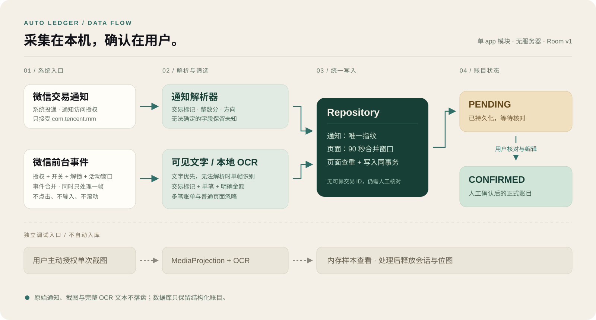

# 架构与设计取舍

[返回首页](../README.md) · [使用与构建](GETTING_STARTED.md) · [验证记录](VERIFICATION.md)

Auto Ledger 是单一 Android `app` 模块。系统服务负责采集，解析器生成结构化候选，Repository 统一去重与写入，Compose 通过 Flow 展示账目。当前主链路没有自动分类器；分类由用户在待确认流程中填写，商户记忆与规则分类仍在计划中。

## 三个入口，两条入库路径

| 入口 | 触发与限制 | 输出 |
| --- | --- | --- |
| `NotificationListenerService` | 系统通知访问授权；包名只接受 `com.tencent.mm` | 通知解析器生成候选并自动交给 Repository |
| `AccessibilityService` | 用户授权；自动采集开关开启；设备解锁且微信为活动窗口 | 可见文字解析，无法形成候选时单帧 OCR；通过页面规则后入库 |
| 单次 `MediaProjection` | 每次由用户主动发起并经系统授权 | 单帧 OCR 结果在内存中展示，目前不调用 Repository |

页面样本调试另有一次性 `armed` 状态：用户主动点击采集后允许读取一份样本；总开关关闭时，样本入口不自动记账。自动采集与调试样本展示不是同一个开关。

所有自动采集候选初始状态均为 `PENDING`。不存在根据置信度直接转为正式账目的实现。缺少金额的疑似通知交易可以待处理，但确认时必须补齐有效金额。

## 1. 缺少交易编号时，如何处理重复采集

内容相同可能是页面重复刷新，也可能是两笔同额消费，因此通知指纹与页面内容指纹分别处理。

**通知路径**：将通知时间按分钟分桶，与规范化文本一起计算 SHA-256。Room 的唯一索引配合 `INSERT IGNORE` 拦截重复指纹。这不等同于支付平台交易 ID：相同文本跨分钟重新投递可能形成新候选，同一分钟内完全相同的两笔交易也可能合并。

**页面路径**：解析器只计算内容指纹。Repository 在同一事务内查询邻近的同来源记录，再决定复用已有指纹，或追加当前采集时间后缀。窗口为首次保存后的 90 秒，重复事件不会延长窗口；同时兼容乱序结果和旧版无后缀指纹，保持 Room schema v1。

| 情况 | 当前行为 |
| --- | --- |
| 同内容在窗口内再次出现 | 复用已有指纹，唯一索引忽略重复写入 |
| 达到 90 秒边界后再次出现 | 生成带新时间后缀的候选指纹 |
| 进程重启后短时再次采集 | 依据数据库记录判断，不依赖进程内缓存 |
| 90 秒内两笔完全同内容的真实交易 | 可能被合并，需要人工核对 |
| 超过窗口重新查看旧账单 | 可能出现新候选，需要人工核对 |

实现：[LedgerRepository.kt](../app/src/main/java/com/liwenzhong/autoledger/repository/LedgerRepository.kt)。测试：[窗口与乱序](../app/src/test/java/com/liwenzhong/autoledger/repository/ScreenObservationDeduplicationTest.kt)、[Room 唯一索引与并发测试代码](../app/src/androidTest/java/com/liwenzhong/autoledger/repository/TransactionDatabaseTest.kt)。并发仪器测试仍待在专用设备执行。

## 2. 单帧 OCR 如何避免堆积与泄漏

微信界面事件先等待 500 ms，合并期间重复事件，再检查设备锁定状态、应用内开关和当前活动窗口。代码优先读取可见文字；读不到文字或文字不能形成交易候选时，再尝试截图。

截图与 OCR 期间设置 `screenshotInFlight`。忙碌时的新事件只记录一次后续请求，处理结束后重新检查条件，不并发排队截取多帧。OCR 在单线程执行器中运行，使用随 APK 分发的简体中文模型；稀疏文本模式适配金额、状态等分散布局，深色背景在内存中反色处理。

位图、硬件缓冲区、OCR 引擎和忙碌状态各有释放路径。尤其在结果处理抛出异常时，仍通过 `finally` 释放忙碌状态，避免后续事件永远被判定为“处理中”。不进行定时轮询、连续录屏或自动滚动。

页面解析需要交易标记与明确的单笔金额。多笔账单、普通页面和不明确金额被忽略；独立负号金额只在已观察到的单笔支付详情结构下接受。当前没有 OCR 准确率基准，不以有限样本推断通用识别能力。

实现：[无障碍服务](../app/src/main/java/com/liwenzhong/autoledger/accessibility/WeChatAccessibilityService.kt)、[本地 OCR](../app/src/main/java/com/liwenzhong/autoledger/capture/OfflineOcrRecognizer.kt)、[页面解析器](../app/src/main/java/com/liwenzhong/autoledger/parser/WeChatScreenParser.kt)。

## 3. 金额、状态与持久化

金额用 `Long` 整数分保存，通过整数运算解析元和小数位，不经浮点数转换。确认时校验金额范围；对象无法确定时保留“未确定”。图表绘制比例使用浮点数，不参与账目金额存储。

Room v1 仅有 `transactions` 表，去重指纹拥有唯一索引。结构由 [导出的 schema](../app/schemas/com.liwenzhong.autoledger.repository.AutoLedgerDatabase/1.json) 固定，禁止破坏性迁移。

| 字段 | 约定 |
| --- | --- |
| `id` / `fingerprint` | 自增本地 ID / 唯一去重指纹 |
| `occurredAtMillis` | 通知发布时间或页面采集时间，不保证等于真实支付时间 |
| `amountCents` | 整数分，可空；确认时必须是有效正数 |
| `direction` / `counterparty` / `source` | 收支方向、交易对象、采集来源 |
| `category` / `classificationSource` | 初始未分类，确认编辑后来源为 `MANUAL` |
| `status` | 初始 `PENDING`，人工确认后更新为 `CONFIRMED` |

Repository 分别提供待确认和已确认的 Flow。首页与统计页当前将二者合并计算，并提示包含待确认数据。确认更新以指纹定位，且只更新仍处于 `PENDING` 的行。

## 4. 可排障，但不保存原文

采集结果区分收到、识别中、已保存、重复、忽略与失败。`CaptureDiagnostics` 在内存中维护最多 12 条事件，以及独立的最近保存与最近失败，普通事件不会抹去这些线索。每条事件只包含来源、状态和时间，进程结束即消失。

数据库写入统一通过 `recordIngestion` 处理异常：普通写入异常变为 `FAILED`，`CancellationException` 继续抛出以保留协程取消语义。异常文本可能包含 SQLite 绑定值，因此不向诊断传递异常消息。

实现：[诊断状态](../app/src/main/java/com/liwenzhong/autoledger/capture/CaptureDiagnostics.kt)、[诊断测试](../app/src/test/java/com/liwenzhong/autoledger/capture/CaptureDiagnosticsTest.kt)、[失败恢复测试](../app/src/test/java/com/liwenzhong/autoledger/repository/IngestionRecoveryTest.kt)。

## 5. 权限、连接与恢复分别建模

通知访问授权存在，不代表通知服务已连接。首页与采集页分别读取系统授权和服务回调状态；界面采集还检查应用内开关。只有条件满足才显示已连接或运行中。

通知服务断开或应用返回前台时，仅在仍有授权且未连接的情况下请求系统重绑。重连成功后重新处理通知栏仍保留的微信通知，由数据库去重；已经消失的通知无法补回。应用不循环拉活或绕过系统强制停止。

所有原始通知、页面文字、截图和完整 OCR 文本仅在内存处理。应用未声明网络权限，不接服务器；云备份与设备迁移规则排除账本数据。详细配置见 [Manifest](../app/src/main/AndroidManifest.xml)、[无障碍能力配置](../app/src/main/res/xml/wechat_accessibility_service.xml)、[隐私说明](../PRIVACY.md)。

## 源码导航

路径均相对 `app/src/main/java/com/liwenzhong/autoledger/`。

| 位置 | 职责 |
| --- | --- |
| `MainActivity.kt` | 权限入口、服务状态、模拟样本与界面装配 |
| `notification/` | 微信通知白名单、自动解析、重连与单次样本 |
| `accessibility/` | 微信前台事件、文字读取、单帧截图与采集开关 |
| `capture/` | 本地 OCR、主动单次屏幕捕获、内存诊断 |
| `parser/` | 通知与页面独立解析，输出统一候选 |
| `repository/` | Room v1、去重事务、确认更新；保留的内存实现不承担当前持久化 |
| `ui/` | Compose 账本、统计、采集、待确认及手动录入预览 |

选择单模块是因为当前只有一个应用和一套本地存储实现；不为尚未实现的分类器、支付来源或同步能力提前增加接口与模块。
